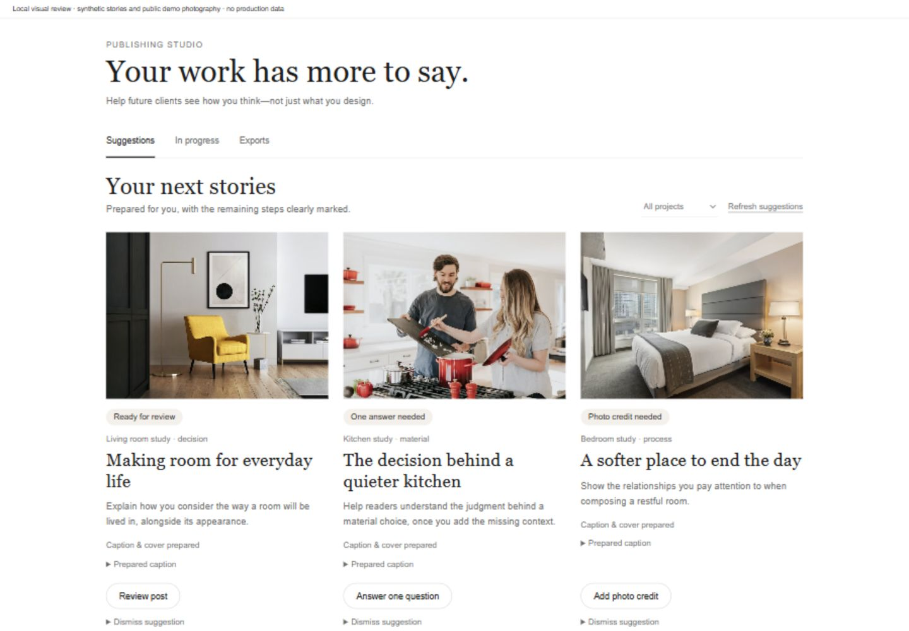

# Folio

**Good design deserves to be published.**

Folio is an AI-assisted publishing platform that gives design studios a publication of their own. It helps designers explain how and why they approach each project, bringing photographs, product references, and their own words together into editorial features and social content they can review and publish.

## Why Folio exists

Good design involves decisions that a photograph alone cannot explain. Communicating that thinking takes interviewing, writing, editing, and production. Studios can hire dedicated media teams or invest in PR to pursue placement in leading publications, but those costs compete with the time and margins available for the design work itself.

Folio reviews your project before you sit down for an interview tailored to your work and perspective. The conversation builds on the material you've shared and the answers you give, drawing out the decisions and thinking behind the design. The aim is to make publication accessible across the industry, so the quality of the work and the ideas behind it can be expressed regardless of a studio's size or media budget.

[AI engineering tour](docs/AI_ENGINEERING.md) · [Development guide](docs/DEVELOPMENT.md) · [Regression journeys](docs/CORE_REGRESSION_JOURNEYS.md)



*Publishing Studio preview from a local UI review, using synthetic stories and demo photography. [Preview context and verification](docs/reviews/studio-redesign/README.md).*

## From project archive to publication

1. **Bring in the project.** Upload photographs, organize rooms, and tag products to preserve the context behind each image.
2. **Tell the story.** Sit down with Folio for an interview informed by your project. Questions evolve with your answers, drawing out the context, choices, and intentions behind the work.
3. **Review the draft.** Generate an illustrated editorial draft, review the text and quotations, and choose how the work is presented.
4. **Publish and reuse.** Publish the approved project and prepare further stories and social assets in Publishing Studio.

The repository also includes live avatar interviews, product attribution, designer profiles, and portfolio-based expertise stories. Availability depends on the configured services, feature flags, and account permissions.

## Longer-term vision

Folio's economic ambition is to make design practice more viable. Reducing the overhead of producing and publishing project stories is intended to protect designers' margins and create room for more accessible client pricing.

Future phases aim to let designers earn from the influence their completed projects generate. That would give quality work an additional way to produce income, allowing designers to grow their earnings without relying solely on higher fees for clients. These future earnings capabilities build on today's focus: capturing expertise, publishing it, and making it reusable.

## Engineering highlights

| Problem | Implementation | Start reading |
| --- | --- | --- |
| An AI conversation must survive retries and interruptions | Versioned interview state, request replay checks, and accepted answers saved before the next model decision | [Guided interview controller](src/lib/interview/guided/controller.ts) and [service](src/lib/interview/guided/service.ts) |
| A follow-up can sound plausible while inventing a premise | Structured proposals, source references, coverage checks, and a separate factual review for podcast-style questions | [Decision pipeline](src/lib/interview/guided/decision.ts) and [factual review](src/lib/interview/guided/factual-review.ts) |
| Generated writing must remain tied to the designer's evidence | Interview provenance, quotation verification, and an author review/publishing workflow | [Editorial generation](src/lib/posting/generateEditorialDraft.ts) and [quote provenance](src/lib/posting/verifyQuoteProvenance.ts) |
| Live speech and typed replies must share the same interview | A provider integration around Folio's canonical interview state and answer-saving paths | [Live interview adapters](src/lib/live-interview/adapters.ts) |
| Fast iteration needs repeatable checks | Application journey tests, interview regression scripts, and CI guards for client imports, migrations, and existing TypeScript debt | [Core journeys](scripts/core/journeys.test.cjs) and [CI workflows](.github/workflows) |

The [engineering tour](docs/AI_ENGINEERING.md) explains these choices, their tradeoffs, and where the verification stops.

## Stack

- **Application:** Next.js 14 App Router, React 18, TypeScript, Tailwind CSS.
- **Data and identity:** PostgreSQL/Supabase, Prisma 6, NextAuth, and application ownership/organization checks.
- **AI:** Anthropic for interview and editorial tasks; OpenAI integrations for transcription and embeddings; Tavus for the optional live conversation interface.
- **Infrastructure:** Vercel, Supabase storage, optional Upstash rate limiting, and separate media/render workers.

## Explore locally

Use Node.js 22 and npm. After cloning the repository:

```sh
npm ci
npm exec -- prisma generate
npm run test:core
npm run test:guided
```

These regression suites use synthetic data and mocked external services. The optional database tests require separate configuration. For the application itself, a development database, storage, authentication configuration, and credentials for the enabled AI features are required. Follow the [development guide](docs/DEVELOPMENT.md) before running `npm run dev`.

## Development approach and status

Folio is an actively developed solo-founder product built with AI coding assistance, including Claude Code and Codex. Product constraints, implementation reviews, and regression checks are part of that workflow. [Contributor guidance](CLAUDE.md) and [specialist review instructions](.claude/agents/README.md) show how the work is organized.

The repository includes established workflows alongside gated features and earlier experiments. TypeScript and lint debt are tracked through CI; a successful application build alone does not establish a clean typecheck. See the [current development constraints](docs/DEVELOPMENT.md#verification-and-current-constraints) for the relevant checks and limitations.
