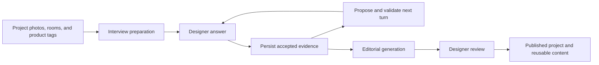

# AI engineering tour

Folio's central workflow turns a designer's project archive and interview answers into reusable, structured source material. This guide follows the implementation from the conversation through editorial generation and review.

## 1. Application state governs the conversation

The model proposes the next conversational move. The application owns question identities, room scope, accepted answers, progression, and completion.

The [controller](../src/lib/interview/guided/controller.ts) validates commands and maintains the interview state. Request IDs and command digests distinguish a retried answer from a reused request ID carrying different content. The [store](../src/lib/interview/guided/store.ts) checks session versions and uses a transaction and compare-and-swap update to protect the persisted state.

The [service](../src/lib/interview/guided/service.ts) commits an accepted answer before requesting the next model decision. A provider failure can therefore leave the interview waiting for recovery while retaining the answer that caused the transition.

**Tradeoff:** this adds explicit states, conflict handling, and recovery UI. It also makes saved evidence and progress inspectable independently of the provider's conversation.

## 2. Structured output is only the first check

The [decision pipeline](../src/lib/interview/guided/decision.ts) uses schemas and application validation to restrict candidate actions. For podcast-style interviews, it also checks whether proposed wording is supported by cited answers and whether the next question addresses an actual remaining gap.

The [factual review prompt](../src/lib/interview/guided/factual-review.ts) tests whether a question embeds an unsupported event, motive, or causal claim. For example, a designer saying two rooms were renovated does not establish that a wall between them was removed. An open question can ask about the connection; it should not assume one.

Coverage proposals refer to accepted evidence. Reusing a passage to satisfy another question requires confirmation. Corrections and room boundaries matter because a valid fact in one part of the interview may be the wrong evidence for another.

**Tradeoff:** additional review calls cost time and money, and model-based review is imperfect. [Task-specific model selection](../src/lib/ai/models.ts) and [cost recording](../src/lib/ai/cost.ts) make those choices explicit. The [project-guide evaluation record](reviews/project-guide/results.md) documents concrete trials and their limitations; it does not establish a general quality or latency guarantee.

## 3. Live interaction shares the saved interview

The [live interview adapters](../src/lib/live-interview/adapters.ts) connect provider events to Folio's existing interview services. The [provider layer](../src/lib/live-interview/provider.ts) handles the Tavus integration, while the application retains responsibility for canonical answers, permissions, and progress.

Typed replies and speech feed the same interview engine. Recorded media is a separate capability with consent, private storage, processing, and export requirements. See the [live interview implementation guide](LIVE_INTERVIEWS.md) for the integration and its rollout history.

**Tradeoff:** a live interface introduces callback authentication, ambiguous delivery, session cleanup, microphone permissions, and media processing concerns beyond text generation. Keeping those concerns distinct from interview evidence makes recovery possible without treating a provider session as the source of truth.

## 4. Generation preserves an evidence trail

The [editorial generator](../src/lib/posting/generateEditorialDraft.ts) draws on project and interview context. [Quote provenance verification](../src/lib/posting/verifyQuoteProvenance.ts) and the [pull-quote checks](../scripts/check-pull-quotes.ts) address the distinction between a designer's direct words and generated editorial language.

Designer review remains a separate step before publication. The core workflow ties photographs, rooms, answers, and product references together so that the resulting content can be reused without discarding its context.

**Tradeoff:** generation quality depends on the available source material. Missing evidence, changed sources, and incomplete attribution need explicit handling; a fluent draft does not resolve those conditions by itself.

## 5. Verification follows the workflow

| Evidence | What it establishes | Important limit |
| --- | --- | --- |
| [Core regression journeys](CORE_REGRESSION_JOURNEYS.md) | Application orchestration across onboarding, project/tagging, ownership, interview/publication, and collaboration | Default runs use a stateful database double and mocked providers |
| [Guided interview service checks](../scripts/check-guided-service.cjs) | Route/service/controller/store behavior, recovery, and canonical answer projection | Transaction boundaries are doubled; this is not PostgreSQL concurrency proof |
| [Conversation evaluation](../scripts/eval-guided-conversation.cjs) | A repeatable way to examine synthetic scenarios and short multi-turn conversations | Live evaluation needs credentials and incurs provider cost; finite examples do not guarantee model behavior |
| [Client import guard](../scripts/guard-client-imports.js) | Source checks against specified server/client boundary violations | Static checks are not a full security audit |
| [TypeScript ratchet](TYPESCRIPT_RATCHET.md) | New diagnostics are checked against an existing baseline | The baseline contains unresolved type errors |

The most useful review path is the guided controller, service, decision pipeline, and their checks. Together they show how probabilistic model output is incorporated into a persistent product workflow.
