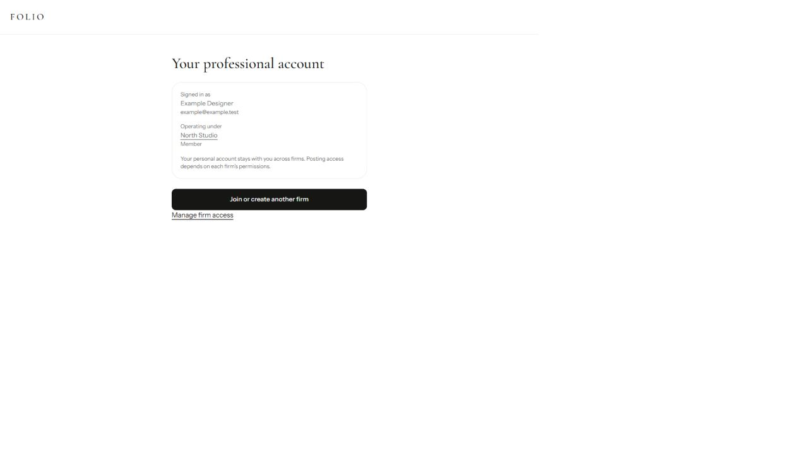

# Professional navigation and account context

The ordinary `/professionals` entry previously fabricated a `/projects/new` callback. Existing members therefore saw a work-selection screen even when they only clicked **For professionals**.

The canonical entry now preserves the distinction between general navigation and an explicit action. Desktop/mobile navigation, auth headers, marketing signup and legacy professional aliases converge on that entry. Authenticated visitors bypass the sign-in form; safe callbacks and selected-firm invitations survive the redirect.

| State | Result |
| --- | --- |
| Signed out | Professional authentication, retaining the requested destination without inventing project intent |
| Signed in, no firm | Current identity/context followed by the existing find/create smart field |
| Signed in, one firm | Account overview with actual operating context and join/create another firm |
| Multiple firms | Same overview, plus membership links and roles |
| Personal context | Explicitly says Your personal account; never assumes the first membership is active |
| Inactive former firm | Personal context and an explanation that previous access is inactive |
| Add another firm | Existing autocomplete enrollment with current account status |
| Explicit project callback | Existing eligible-firm choice, preserving the intended action |
| View-only membership | Visible status; View firm rather than a posting/workspace action |

Account status reads the signed-in user's current database context and active memberships. Overview links do not switch workspaces or grant posting rights. No schema or permission policy changes.

## Verification

Routing, professional-entry, auth-alias, enrollment and join-notification regression scripts pass. Core suite: 8 passed, 1 disposable-database test skipped. Scoped ESLint and client-import guard pass. Next production compilation passes. TypeScript ratchet passes at 903 diagnostics against the unchanged 904 baseline.

Browser checks use the real client components in a synthetic loopback fixture, with mocked navigation/API effects: desktop and 390 x 844 account overview, multiple memberships, personal context and add-firm layout. Server redirects are verified by focused route tests. No live account writes, emails or deployment were performed.

Build and serve using `node scripts/build-firm-enrollment-preview.cjs --serve`. Modes: `?mode=account`, `multiple`, `personal`, `stale`, `viewer`, and `memberships` (explicit project choice). The existing join/create scenarios remain available.

