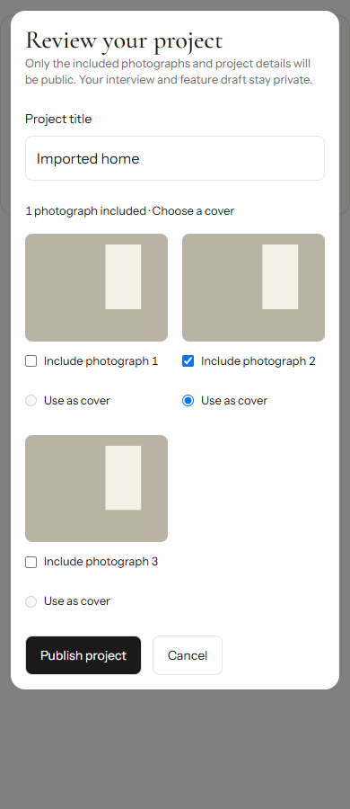
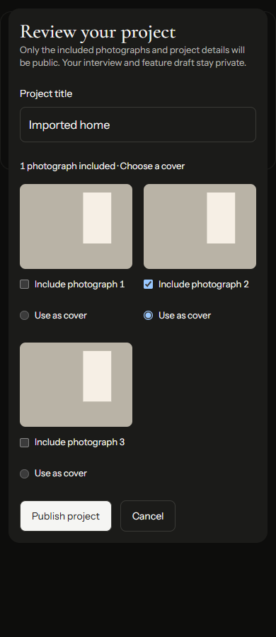
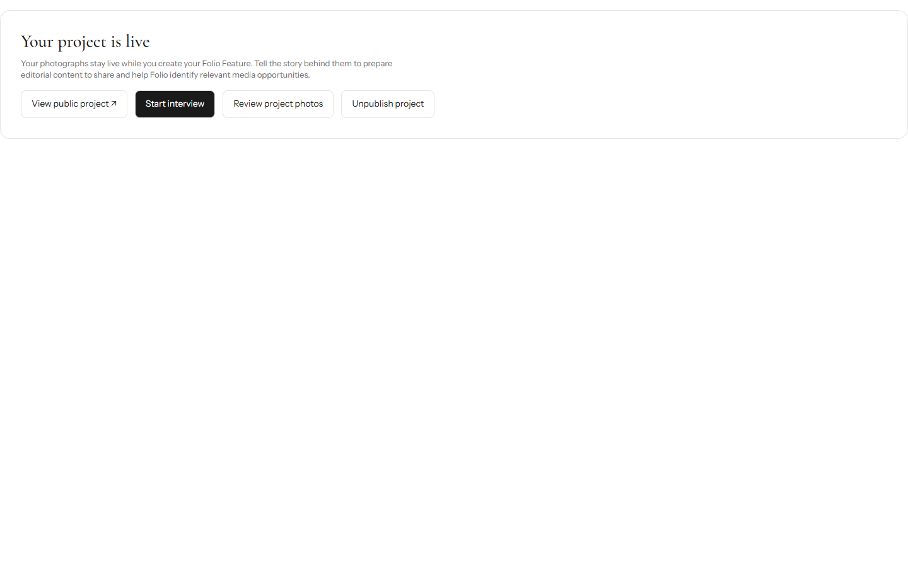

# Quick-publish journey

Status: implemented on `codex/quick-publish-journey`, based on main after PR #856. Ready for review after the checks below; not merged or deployed.

## Core decision

A designer can publish a photographic project before doing an interview. The project and its Folio Feature have independent publication intent. Completing the interview adds context, quotations and editorial possibilities to an already useful public project.

Approved direction: room organization is optional for quick publishing and comes later when preparing the interview.

## Designer journey

1. **Import privately.** Save each project's photos and available details, preserve the source, and show the import's current completion or attention state. Importing never publishes anything.
2. **Review the project.** Show the title, cover and included photos together. Allow changing the title and cover, leaving photos out, and viewing the public presentation. Do not require room names, product tags, a finish schedule or an interview. Late or retried imports into a live project arrive excluded until the owner reviews them. At least one saved, included photograph and a nonempty title are required; source documents do not count as photographs. Existing publication authorization still applies.
3. **Publish the project.** An explicit action publishes only the reviewed photo project. Show its public link and a success state. An empty interview draft created by import cannot block this action. It also cannot be published as an article by this action.
4. **Invite the story.** Show a persistent owner prompt and create one in-app interview invitation after the first successful publication. The prompt explains the Folio Feature, editorial sharing assets and eligibility for relevant media opportunities. It must not promise placement or bypass existing opportunity readiness rules. Repeated publish requests must not create repeated notices. Publishing the feature resolves its earlier interview invitation. There is one in-app invitation per project, with no popup or new email campaign. A batch-publication flow and grouped invitations are future work.
5. **Build the feature alongside the public project.** Starting, saving, generating or reviewing the interview keeps the photo project live. The feature stays private until separately published through its existing review and publication rules. The owner prompt changes to Continue interview, Review your feature or View your feature as appropriate.

Suggested owner copy:

> Your project is live.
> Tell the story behind it to create your Folio Feature, prepare editorial content to share, and help Folio identify relevant media opportunities.
> Start interview

The persistent prompt belongs in the owner's workspace. Visitors continue to see the complete cinematic photo project, without unfinished-work messaging.

## Room organization: next iteration

Treat organizing spaces and tagging products as different tasks. Room grouping gives the interview context; product tagging identifies the pieces in the photographs.

- Offer room grouping when preparing the interview, with a way to return later.
- Let the designer select several photographs and assign them to an existing space or name a new space once. Selection must work by touch and keyboard, without requiring dragging.
- Keep named groups visible so the designer can move a selection, rename a space or undo an assignment without repeating work.
- Support non-room subjects such as exterior and details without forcing incorrect room labels.
- Preserve included/excluded decisions when organizing photos. Bulk grouping must not silently bring excluded photographs back into the public project.
- Do not restore the retired automatic room-detection endpoint. Any later assistance should propose groups for review, rather than silently changing saved assignments.
- Unorganized photos stay visible on the photo project. If feature generation needs more organization, explain the specific missing association there rather than blocking quick publication.

## Publication and privacy contract

| Photo project | Feature | Visitor experience |
| --- | --- | --- |
| Private | Absent or private | No public project or feature |
| Explicitly published | Absent or private | Cinematic photographs; no feature button, draft text or interview evidence |
| Explicitly published | Published | Project with selected quotation teasers and exact-photo feature links |
| Explicitly unpublished | Any | Neither project nor feature accessible publicly |

An explicit photo-publication record is needed so feature editing or review cannot erase the designer's separate decision to publish the project. Existing article-only projects must retain their current withdrawal behavior unless their owner explicitly publishes a photo portfolio. Never infer new publication consent from an old timestamp, an imported draft, a room assignment or a rejected/archived article.

The new portfolio action must be distinct from the feature publishing action, transactional and idempotent. Use the existing public project route and its allowlisted data transport; do not expose draft article properties to obtain the cover or credits. A selected cover must be an included photo belonging to this project. Previously hidden projects must not become visible because this feature ships.

## Original implementation findings

- `src/lib/workspace-import/processor.ts` creates private projects and an empty guided post. Imported photo rows are not assigned to rooms. Its ready notification currently recommends materials before the interview.
- `src/app/actions/projects.ts` requires room completeness, then sends every project with a post through the editorial lifecycle. The empty imported draft therefore blocks photo-only publication even after sorting.
- `src/lib/editorial/lifecycle.ts` couples project visibility to feature transitions. Removing only the quick-publish gate would not preserve a live portfolio throughout later feature work.
- `src/lib/project-channel/getPublicPortfolio.ts` already supports an explicitly public photographic project, including photos without room assignments, without transporting draft interview data.
- `src/app/project/[id]/page.tsx` largely derives its workspace journey from the editorial publication state. It needs a separate photo-project success/continuation state.
- `src/app/project/[id]/RoomGroupedMedia.tsx` primarily assigns one photograph at a time. Its existing non-drag menus and server authorization can inform accessible bulk selection.

## Implementation scope and acceptance checks

1. Establish separate explicit portfolio publication intent and lifecycle behavior. Check publish permissions, excluded photos, invalid covers, empty imports, retry/concurrency behavior, and preservation of private/review/archived legacy projects.
2. Connect import review and the project workspace to quick publishing. Check successful publication with unsorted photos and an empty guided draft; allow partial imports only after the designer reviews the saved photos.
3. Add the one-time in-app invitation and persistent owner action. Check notification deduplication, unavailable/revoked access, resumed interviews and feature publication. No real notifications should be sent during testing.
4. Add bulk room grouping as a focused follow-up to the working photo-first journey. Check touch, keyboard, multiple selection, undo, cross-project authorization and preservation of exclusions.
5. Verify the full journey in both themes and on mobile: import → review → public photos → interview → private feature draft → published feature. Confirm the public project remains live through the middle steps and that explicit project unpublication hides all public surfaces.

## Review evidence and release order

The implemented review is an accessible dialog in the existing project workspace. It includes the public description, editable title, included-photo choices and cover selection. Import cards open this review; the success panel links to the public project and the current interview/feature step. The room and product workspace remains available, with bulk room grouping reserved for the next iteration.

The additive migration `20261116213000_portfolio_publication` must be applied before this code is served. It adds nullable portfolio consent and cover fields without backfilling old records. Apply it only to the approved release target; no production database changes were made during this task. On rollback, leave the additive columns in place. The existing `FOLIO_EDITORIAL_CHANNELS` switch continues to control the cinematic public and review surfaces.

Validation covers the real publication service and authorization with synthetic model boundaries, PGlite migration repeatability and null consent, the actual generation save path, private/draft/feature route behavior, stable shared channels, profile feed links, import regressions, and Chromium review interactions at 320/390/1440 pixels in both themes. The browser uses actual components and CSS with synthetic photos and action doubles; it does not claim live account, email-provider or production-database verification. Database transaction isolation and retries are configured, but the memory model tests do not prove production concurrency.

Previews show synthetic photographs:

The production build, scoped lint, client boundary and migration/design checks pass. The TypeScript baseline remains 846 with no additions. Adding the two Project fields changes 26 existing diagnostic displays; `quick-publish-typescript-proof.json` compares the same compiler, source hashes/spans and full type messages against main. Exact display equivalences account only for those two added fields, without changing the baseline or widening the guard.
